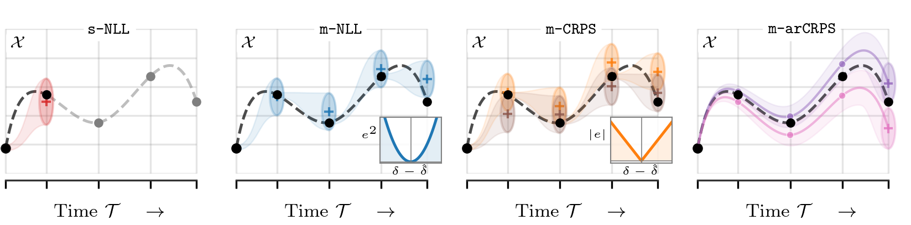

# Gibbs Variational Last Layers

Code for *Gibbs Variational Last Layers for Long-Horizon Dynamics Learning* (NeurIPS 2026).

Variational Bayesian last layers (VBLLs) are usually trained with a single-step likelihood. We view VBLL training as Gibbs variational inference, which decouples posterior inference from the training loss, and use this to train VBLL dynamics models with multi-step, CRPS-based and fully autoregressive objectives.



## Installation

We use [uv](https://docs.astral.sh/uv/) and Python 3.12.

```bash
git clone https://github.com/brunzema/gibbs-vbll.git
cd gibbs-vbll
uv sync                 # CPU
uv sync --extra cuda    # NVIDIA GPU (CUDA 12)
```

## Losses

All models share the same delta-VBLL architecture; only the training loss changes. Select it with `training=<name>` (simulated systems) or `loss=<name>` (Wheelbot). The implementations are in `src/training/`.

| Config name                | Paper      | Description                                              |
| -------------------------- | ---------- | -------------------------------------------------------- |
| `single_step_elbo`         | `s-NLL`    | Standard single-step VBLL objective (ELBO)               |
| `single_step_elbo_hbatch`  | `s-NLL-HB` | s-NLL with batch size 64·H (same transitions per step)   |
| `multi_step_elbo`          | `m-NLL`    | Teacher-forced multi-step Gaussian log score             |
| `multi_step_factored_crps` | `m-CRPS`   | Teacher-forced Gaussian CRPS, sampled last-layer weights |
| `multi_step_kde`           | `m-KDE`    | KDE log-likelihood on autoregressive rollouts            |
| `multi_step_ar_crps`       | `m-arCRPS` | Autoregressive Gaussian CRPS                             |
| `multi_step_ar_elbo`       | `m-arNLL`  | Autoregressive Gaussian log score                        |

## Usage

Train on a simulated system (`spiral`, `swimmer`, `variable_speed_limit_cycle`, `bifurcating_limit_cycle`, `glycolytic_oscillator`, or one of 13 [dysts](https://github.com/williamgilpin/dysts) systems) with the paper settings:

```bash
uv run python runs/train.py +experiment=paper sweep_name=<sweep_name> \
    environment=variable_speed_limit_cycle training=multi_step_ar_crps

uv run python runs/train.py +experiment=paper sweep_name=<sweep_name> \
    environment=dysts dysts_system=lorenz training=multi_step_ar_crps
```

Compare all losses on one environment:

```bash
uv run python runs/eval.py --config-name eval_variable_speed_limit_cycle sweep_name=<sweep_name>
```

Train on the [Mini Wheelbot dataset](https://github.com/wheelbot/dataset) (expects the racing data in `data/wheelbot_racing/{train,val,test}/`) and compute the metrics for the results table:

```bash
uv run python runs/wheelbot_dynamics.py loss=multi_step_ar_crps sweep_name=<wb_sweep_name>
uv run python runs/eval_wheelbot.py <wb_sweep_name>
```

Models, resolved configs and CSV logs are written to `results/`.

## Reproducing the paper

The sweeps run on Slurm via Hydra's submitit launcher. Set `base_path` in `config/path/cluster.yaml` (and `config/wheelbot_dynamics/path/cluster.yaml`) and export `SLURM_ACCOUNT` if your cluster needs one, then:

```bash
bash scripts/cluster_train_all_envs.sh <sweep_name>                   # 7 losses × 18 simulated systems
EVALUATION=paper INCLUDE_DYSTS=1 bash scripts/cluster_eval_all_envs.sh <sweep_name>
bash scripts/cluster_train_wheelbot.sh <wb_sweep_name>                # Wheelbot, one GPU per run
uv run python runs/eval_wheelbot.py <wb_sweep_name>
```

Use `SEEDS=42,43,44` to run several seeds. All main-body figures and tables are then made with (LaTeX required):

```bash
SWEEP_NAME=<sweep_name> WB_SWEEP_NAME=<wb_sweep_name> plots/make_all.sh
```

## Citation

```bibtex
@inproceedings{brunzema2026gibbs,
  title     = {{Gibbs} Variational Last Layers for Long-Horizon Dynamics Learning},
  author    = {Brunzema, Paul and Henrik Hose and Sebastian Trimpe},
  booktitle = {Advances in Neural Information Processing Systems (NeurIPS)},
  year      = {2026}
}
```
